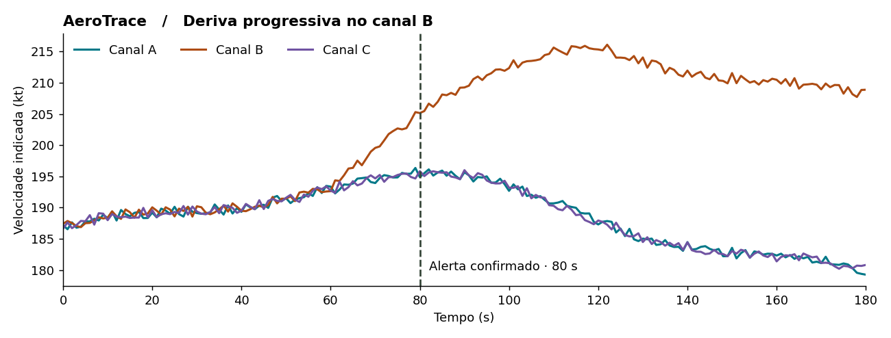

# AeroTrace | Laboratório de telemetria aeronáutica

Como identificar um sensor que começa a indicar uma velocidade diferente dos outros dois? O AeroTrace reproduz 180 segundos de telemetria sintética, permite inspecionar cada segundo e mostra o efeito de duas decisões de engenharia sobre o diagnóstico: limiar e persistência.

## Abrir no Windows

Baixe o ZIP, escolha **Extrair tudo** e abra **index.html** na pasta extraída. O painel funciona offline. No VS Code, com o PowerShell aberto nessa pasta, o comando equivalente é:

~~~powershell
start .\index.html
~~~

## Investigação em um minuto

1. Abra **Deriva progressiva** com limiar de 8 kt e persistência de 3 amostras. Clique no evento **80 s · Canal B**. O cursor vai à confirmação e o painel mostra o desvio em relação à mediana.
2. Volte o cursor para 78 s. O canal já cruzou o limiar. A confirmação espera a terceira leitura consecutiva. A deriva foi introduzida aos 60 s, portanto a latência total foi de 20 s.
3. Selecione **Pico transitório**. Reduza a persistência de 3 para 1. O pico de uma amostra em 83 s passa a gerar um evento.
4. Selecione **Falha de modo comum**. Os três sinais sobem juntos em 60 s e a comparação relativa perde a falha. Para investigar esse caso seria necessária uma referência independente.

O gráfico mostra todo o registro. O cursor controla o instante exibido nas leituras, e **Reproduzir** avança a 10 segundos simulados por segundo real. **Exportar CSV** baixa as 181 linhas com as leituras, mediana e estado de alarme por canal.

## Como funciona

A cada segundo, o detector ordena três leituras e toma o valor central como referência. Para cada canal, calcula o valor absoluto da diferença para a mediana. Um contador aumenta enquanto o desvio supera o limiar e volta a zero quando o desvio fica igual ou abaixo dele. O detector registra um evento ao atingir o número exigido de amostras consecutivas. A lista de eventos cobre o registro inteiro.

O gerador usa ruído pseudoaleatório com semente fixa, permitindo comparar configurações sobre os mesmos dados. O detector recebe somente as amostras e os parâmetros escolhidos. Os rótulos de falhas ficam no simulador.

## Reproduzir os testes

Com Node.js 20 ou superior, abra o terminal na pasta do projeto:

~~~sh
node --test engine.test.js
~~~

Oito testes cobrem o cenário nominal, a deriva, o pico com duas persistências, a falha comum, a repetibilidade, o reinício do contador no limiar e a validação de parâmetros.

| Arquivo | Responsabilidade |
| --- | --- |
| engine.js | Geração determinística de sinais e análise por mediana |
| app.js | Interação, gráfico e exportação CSV |
| index.html e style.css | Estrutura e apresentação do painel |
| engine.test.js | Testes do motor de análise |

## Escopo e autoria

Projeto independente de portfólio. A versão inicial do código, testes e documentação foi gerada com auxílio de IA. Todos os sinais e falhas são sintéticos. O modelo simplifica a dinâmica de voo e supõe amostras completas, sincronizadas e espaçadas de um segundo. Limiares e valores foram escolhidos para fins didáticos. Uso exclusivamente educacional, sem vínculo com fabricantes.
